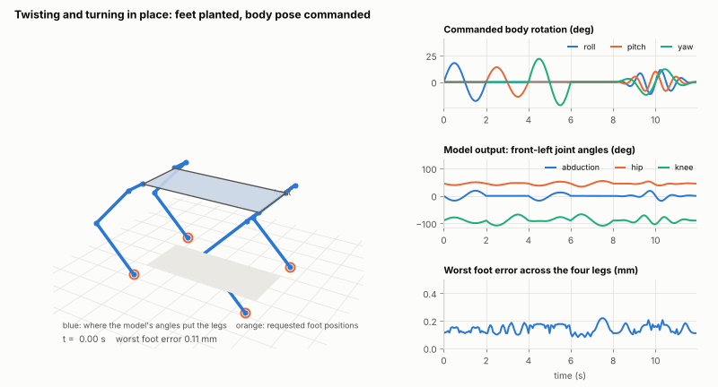
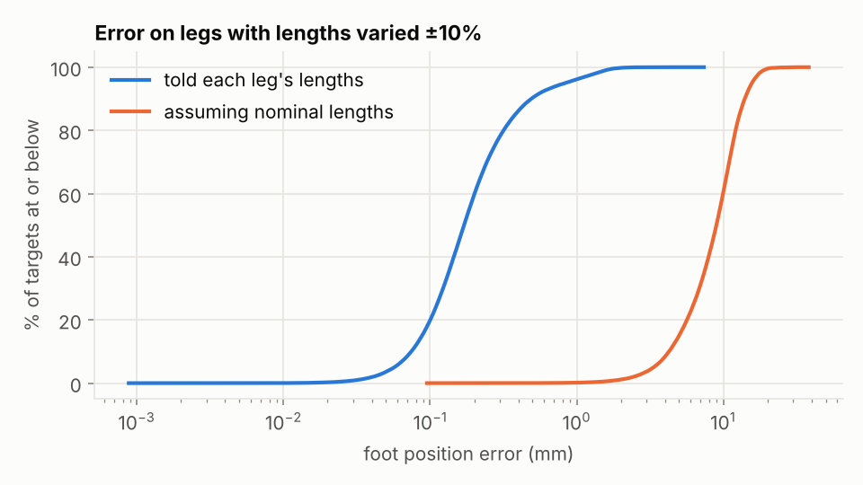
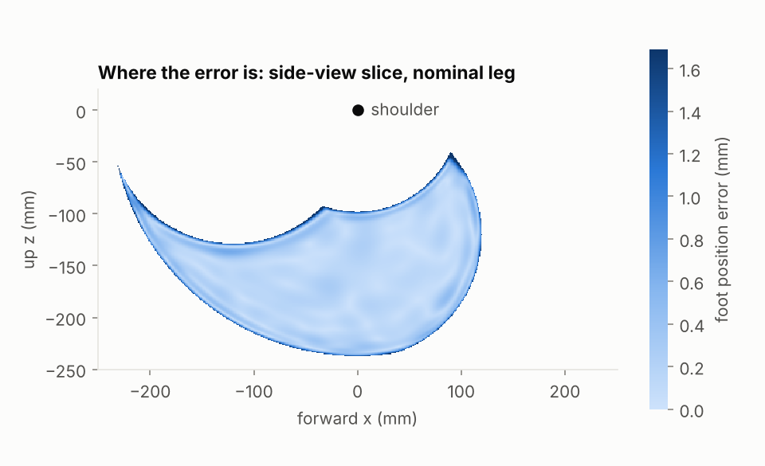
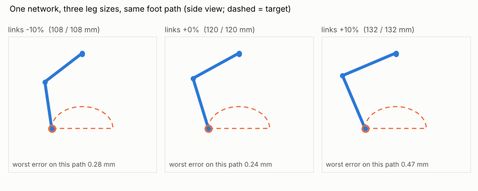
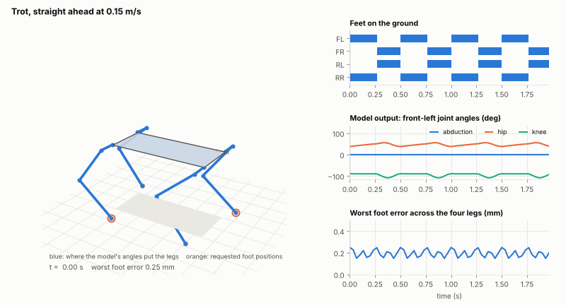
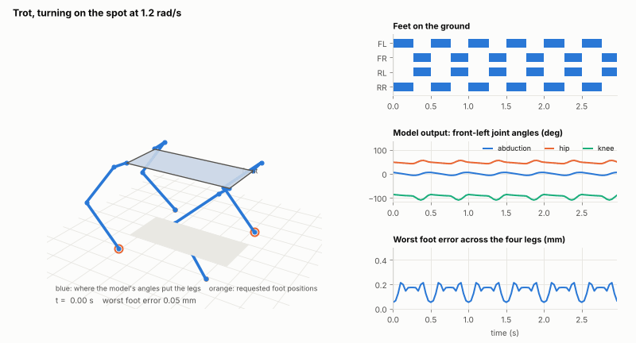
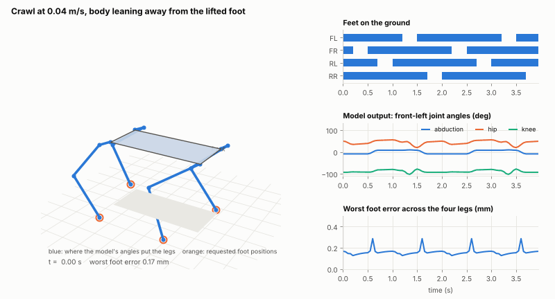

# Mojito


Robots that learn to move in their environment by themselves: a first idea of
the task from simulation, then refinement from real interaction, with return
trips to simulation to prepare for specific tasks.

The first robot is a quadruped with 12 degrees of freedom, 3 per leg:
abduction and hip pitch at the shoulder, and a knee. The feet are grippy pads.



*Every leg in this animation is drawn from the joint angles a trained neural
network produced. The orange rings are where the feet were asked to be.*

## Website

A static site with a progress report, the theory and implementation, every result graphed, all the demos, and a playground
where the robot's dimensions, posture, gait, mass and servo settings can be changed (a live kinematic lab, and a replay of 144 recorded
MuJoCo runs). It reads the numbers from `results/*.json`; it holds none of its own.

```bash
python scripts/build_site.py                 # site/data and site/media from results/ (not committed)
python -m http.server -d site 8000           # open http://127.0.0.1:8000
python scripts/site_sweep.py                 # re-run the 144 MuJoCo runs behind the physics lab (needs mujoco, about 2 minutes)
```

The `site` workflow publishes it with GitHub Pages when `main` changes (one-time: Settings, Pages, Source: GitHub Actions). The kinematic lab uses
the closed-form IK in JavaScript (`site/assets/mojito.js`), checked against the Python by `tests/test_site_js.py` (needs Node).

## Status

| Stage | What | State |
|---|---|---|
| 0 | One network learns inverse kinematics for a leg, with link lengths as inputs | Done |
| 1 | Whole body: posture control, trot and crawl, NumPy or PyTorch | Done |
| – | Robots defined in URDF; the network is generated from it | Done |
| 2 | Physics simulation (MuJoCo) and learned locomotion | In progress: MuJoCo model and servo/sensor model built (work packages 0–3 of 8); gait replay in physics next |
| 3 | The real robot: measurement, calibration, per-leg correction | Planned |
| 4 | The loop: real experience updates the simulator, retrain, redeploy | Planned |

The reasoning behind each stage is in [docs/PLAN.md](docs/PLAN.md).

**Read this before trusting any number below.** Everything so far is geometry.
There is no physics yet, so nothing here says the robot would balance, that
its motors are strong enough, or that its feet would grip. All dimensions and
joint limits are placeholders, not a real robot's:

| Placeholder | Value |
|---|---|
| Abduction offset / upper leg / lower leg | 40 / 120 / 120 mm |
| Shoulder spacing, front to back / side to side | 240 / 100 mm |
| Standing height of the shoulders | 170 mm |
| Joint limits: abduction / hip pitch / knee | ±0.6 / 0 to 1.5 / −2.3 to −0.3 rad |

## Quick start

Python 3.10 or newer. No GPU needed.

```bash
git clone https://github.com/mi897/mojito && cd mojito
pip install -r requirements.txt          # NumPy, SciPy, Matplotlib, Pillow
python -m unittest discover tests        # 72 tests; the 7 PyTorch ones skip if torch is absent
python scripts/make_body_demos.py        # re-render the animations from the trained network
```

The trained network is in the repository (`weights/ik_leg.npz`), so nothing
needs training to try it. Open `docs/demo.html` in a browser to drag a foot
target around and change the link lengths live.

| Script | What it does | Writes |
|---|---|---|
| `scripts/train.py` | Train the leg network (about 12 minutes on 2 CPU cores) | `weights/ik_leg.npz`, `results/training_log.json` |
| `scripts/evaluate.py` | Compare the network with exact IK | `results/metrics.json`, four plots |
| `scripts/calibrate.py` | Adapt to a simulated leg with unknown lengths | `results/calibration.json` |
| `scripts/make_demo.py` | Single-leg demos | `results/step_demo.gif`, `docs/demo.html` |
| `scripts/make_body_demos.py` | Posture, trot and crawl animations (`--no-gif` for numbers only) | four GIFs, `results/body_metrics.json` |

Every script takes `--backend numpy|torch` and `--help`.

## Using it

### One leg

Link lengths are never constants inside the maths. Every function takes them
as an argument, so they can differ per leg and change at any time.

```python
import numpy as np
import mojito
from mojito import leg

net = mojito.load_model("weights/ik_leg.npz")
my_leg = np.array([0.042, 0.115, 0.128])          # abduction offset, upper, lower [m]
target = np.array([0.03, 0.05, -0.18])            # foot position in the shoulder frame [m]

q = net.predict_leg(target, my_leg)               # left leg: abduction, hip pitch, knee [rad]
q_right = net.predict_leg(target, my_leg, right=True)
print(leg.forward(q, my_leg))                     # where those angles put a left foot
print(leg.analytic_ik(target, my_leg))            # the exact answer, for comparison
```

### The whole body

```python
import numpy as np
import mojito
from mojito import body, gaits

robot = body.Robot(mojito.load_model("weights/ik_leg.npz"))   # or body.AnalyticSolver()
home = robot.stance()                                 # feet under the hips, body frame

# Posture: keep the feet where they are, move and tilt the body.
targets = body.apply_posture(home, offset=(0, 0, 0.02), roll=0.2, yaw=0.3)
q = robot.solve(targets)                              # (4, 3) joint angles, legs in FL FR RL RR order
print(robot.tracking_error(targets, q) * 1000)        # mm per foot
print(robot.reachable(targets))                       # inside the joint limits?

# Gait: foot targets for a velocity command.
t = np.linspace(0, 1, 100)
feet, contact, _ = gaits.foot_targets(gaits.TROT, t, home, velocity=(0.15, 0.0), yaw_rate=0.3)
q = robot.solve(feet)                                 # (100, 4, 3)

robot.lengths[0] = [0.041, 0.118, 0.125]              # give one leg different lengths
```

### NumPy or PyTorch

The leg network has two interchangeable backends. **NumPy is the default** and
needs nothing extra. PyTorch is optional (`pip install torch`) and is imported
only when asked for.

| Scope | How |
|---|---|
| One command | `python scripts/train.py --backend torch` |
| Whole shell session | `export MOJITO_BACKEND=torch` |
| The rest of a Python process | `mojito.set_backend("torch")` |
| One call | `mojito.load_model("weights/ik_leg.npz", backend="torch")` |

```python
net = mojito.load_model("weights/ik_leg.npz")                   # NumPy unless told otherwise
net = mojito.load_model("weights/ik_leg.npz", backend="torch")  # same file, PyTorch
new = mojito.make_model(backend="torch", device="cuda")         # untrained, on a GPU
```

- Both backends read and write the same weight files and start from identical
  weights for a given seed.
- `predict` takes and returns NumPy arrays on both, so the body, gait and demo
  code does not care which is active.
- Inside a larger PyTorch model, use `net.angles(target_position, lengths)` and
  `mojito.torch_model.forward_kinematics(joint_angles, lengths)`: tensors in, tensors
  out, differentiable.
- The tests check that the two backends agree on predictions, gradients and
  the path training takes. They run on both backends for every push.

### Training for a different leg

```bash
python scripts/train.py --upper 0.15 --lower 0.14 --abduction 0.05 --tolerance 0.2
```

`--tolerance` is how far each length is varied in training (0.2 means ±20%).
Joint limits live in `JOINT_LIMITS` in `mojito/leg.py`. After retraining,
re-run the other scripts so the results match the new weights.

### Robots from URDF

The robot is defined in a standard URDF, separate from the learning code, and
the network is generated from it. Nothing about the limb (joint count, axes,
limits, link lengths) is written in Python.

```
robots/quadruped.urdf + quadruped.json   <- the definition (any tool can read the URDF)
        |  mojito.urdf     parse / write the URDF (pure Python, no NumPy)
        v
   RobotSpec / LimbSpec                  <- mojito.spec: the alignment layer
        |  mojito.kinematics  forward kinematics + Jacobian for any serial chain
        v                      (NumPy arrays or torch tensors, same code)
     IKNet(spec)                         <- inputs and outputs sized from the chain
```

```bash
python -m mojito.spec robots/quadruped.urdf --manifest robots/quadruped.json   # what the model will see
python scripts/train.py --urdf robots/quadruped.urdf --manifest robots/quadruped.json
python scripts/calibrate.py --urdf robots/quadruped.urdf --manifest robots/quadruped.json --limb FR
```

```python
import mojito
from mojito import body, IKNet

robot = mojito.load_robot("robots/hexapod.urdf", "robots/hexapod.json")   # 6 legs, one network
net = IKNet.load("weights/ik_leg.npz", spec=robot.groups["leg"].canonical) # fails with a diff if they disagree
rig = body.URDFRobot(robot, net)
q = rig.solve(rig.stance())                                                # joint values per limb
```

**What the URDF decides.** Which joints each limb has and their axes and
limits (structure); how many free link lengths there are (one per link with a
non-zero origin translation, direction fixed); where each limb is mounted. The
free lengths are the network's "link length" inputs, so a longer leg in the
URDF needs no retraining, while a different joint limit does.

**What the manifest adds** (a small JSON file beside the URDF, so the URDF
stays a plain URDF): which links are limb tips, which limbs are mirror images
of which, group names, the length tolerance used in training, and an optional
`reach` that scales positions. With no manifest, every leaf link is a limb.

**Alignment.** Limbs with the same structure share one network (a "group").
A limb that is the mirror image of another joins its group, and the sign flips
that relate the two are found and verified numerically instead of assumed. The
limb description is saved inside the weight file with a signature, so loading
weights against a URDF raises `SpecMismatch` with a line for every difference
(joint limit, axis, number of lengths, kinematics). Weights from before this
layer load too, and are checked against the URDF the same way. Calibrated link
lengths go back into a copy of the URDF with `RobotSpec.write_back`.

**Limits.** Serial chains of revolute, continuous, prismatic and fixed joints
only: no branching limbs, closed loops, `<mimic>` or xacro. With more than 3
joints per limb the position-only IK is redundant, so the network learns one of
many valid solutions; resolving that is Stage 2. `evaluate.py` falls back to a
numeric solver where there is no closed form, and `make_demo.py` and the
side-view error map are for the 3-joint leg only. The gaits
(`gaits.py`) and `body.Robot` assume four legs in FL, FR, RL, RR order;
`body.URDFRobot` handles any limb layout (posture and solving, as in the
hexapod example) but has no gaits.

## Results

All numbers come from the JSON files in `results/`, produced by the scripts
above with the committed weights.

### Stage 0: one leg

Each link length was varied independently by ±10% in training. Tested on
200,000 foot targets and leg sizes the network never saw. The leg reaches
240 mm.

| Foot position error | Median | 95th pct | 99th pct | Worst |
|---|---|---|---|---|
| Network, told each leg's lengths | 0.17 mm | 0.84 mm | 1.57 mm | 7.4 mm |
| Network, assuming every leg is nominal | 9.0 mm | 15.7 mm | 18.8 mm | 38.3 mm |
| Closed-form IK on an ideal leg | exact | exact | exact | exact |

- **The length input is what makes one network cover many legs.** Without it
  the median error is about 50 times larger.
- **Joint angles** are within 0.04° of the exact solution at the median and
  0.53° at the 95th percentile.
- **The worst cases are at the edge of the workspace** (error map below). The
  7.4 mm worst case is real and is about 3% of the leg's reach.
- **Outside the trained range** accuracy falls off smoothly: with all links
  scaled by ±20% the median is 1.8 to 1.9 mm.
- **On an ideal leg the closed-form solution is better.** It is exact and
  about 40 times faster in a batch. The network earns its place only by being
  adaptable, which is the next result.

**Adapting to one specific leg.** `scripts/calibrate.py` simulates a leg whose
true lengths (+6%, −5%, +8%) and servo zero points (2°, −3°, 4°) are unknown.
From 30 foot measurements with 1 mm of noise it estimates all six numbers and
hands the lengths to the same network. Nothing is retrained.

| | Median error | 95th pct |
|---|---|---|
| Before calibration | 16.1 mm | 18.6 mm |
| After calibration | 0.56 mm | 0.74 mm |

| | |
|---|---|
|  |  |
|  |  |



### Stage 1: whole body

One shared network drives all four legs. In each animation the side panels
show the command, the network's output for the front-left leg, and the worst
foot error at that instant.

| Trot, straight | Trot, turning on the spot |
|---|---|
|  |  |

| Crawl, leaning away from the lifted foot |
|---|
|  |

| Demo | Worst foot error | Median | Closest any joint gets to its limit | Feet down |
|---|---|---|---|---|
| Posture: roll ±18°, pitch ±14°, yaw ±22°, height ±30 mm | 0.22 mm | 0.11 mm | 15° | 4 |
| Trot forward, 0.15 m/s | 0.25 mm | 0.14 mm | 23° | 2 |
| Trot turning on the spot, 1.2 rad/s | 0.21 mm | 0.10 mm | 22° | 2 |
| Crawl forward, 0.04 m/s | 0.29 mm | 0.12 mm | 20° | 3 or 4 |

- Every requested foot position in all four demos is inside the joint limits.
  The network's angles differ from the exact solution by at most 0.14°.
- **Grounded feet do not slide.** The gait generator holds each stance foot
  fixed in the world for any mix of forward, sideways and turning speed. The
  tests check this to a nanometre using exact IK.
- **The crawl is statically stable on paper.** The body centre stays at least
  37 mm inside the triangle of grounded feet. This treats the body centre as
  the centre of mass, which is an assumption.

Known weaknesses of these motions:

- The trot has two feet down, so it relies on dynamic balance that geometry
  cannot check. With two feet the body centre is never inside a support
  polygon: in the forward trot it ends up as much as 11 mm off the line
  between the grounded feet (`body_centre_inside_support_mm_min` in
  `results/body_metrics.json`).
- The crawl's lean is quick: the body shifts 50 mm in 0.2 s.
- The gaits take a constant velocity command. Changing speed mid-stride is
  not handled yet.

## How it works

**The leg network.** Inputs are the foot target (3 numbers) and the leg's
three link lengths. Outputs are three joint angles, squashed so they always
lie inside the joint limits. It has 3 hidden layers of 128 units, about 34,000
weights.

- **Training data.** Random joint angles are pushed through forward kinematics
  to get foot positions, so every target is reachable. Poses are resampled so
  foot positions cover the workspace more evenly.
- **Loss.** The predicted angles are pushed through forward kinematics and
  compared with the requested foot position. The network is never shown the
  angles that generated the target, so it cannot average two valid poses into
  an invalid one.
- **One answer per target.** The knee bends one way only and stops 0.3 rad
  short of straight.
- **One model for four legs.** A right leg is the mirror image of a left leg:
  flip the target's y on the way in and the abduction angle on the way out.
- **Gradients.** The NumPy backend uses a hand-derived Jacobian, checked
  against finite differences. The PyTorch backend uses autograd.

**The body.** `body.Robot` holds the four shoulder positions and each leg's
lengths. A body pose or gait produces foot targets in the body frame; each is
moved into its leg's shoulder frame and solved by the leg network.

**Gaits.** A foot in stance is held fixed on the ground, so in the body frame
it moves exactly opposite to the commanded body motion. A foot in swing lifts
and travels to where its next stance begins. Trot moves diagonal pairs
together. Crawl lifts one foot at a time and shifts the body away from it
while all four are down.

**Frames and units.** Metres and radians in code. Leg frame: origin at the
shoulder, x forward, y out to the side, z up. Body frame: origin at the centre
of the four shoulders, x forward, y left, z up. Legs are always ordered FL,
FR, RL, RR.

## Repository layout

```
mojito/urdf.py         read and write URDF (no NumPy)
mojito/spec.py         URDF + manifest -> LimbSpec / RobotSpec; groups, mirrors, checks, write-back
mojito/kinematics.py   forward kinematics, Jacobian, numeric IK for any serial chain
mojito/robots.py       generators for the example URDFs in robots/
mojito/leg.py          the 3-joint leg: closed-form IK (reference), sampling
mojito/model.py        the leg network, NumPy backend; shared base class
mojito/torch_model.py  the leg network, PyTorch backend
mojito/backend.py      backend switch: make_model, load_model, set_backend
mojito/body.py         legs on a body: frames, posture, per-leg solving (Robot: quadruped; URDFRobot: any URDF)
mojito/gaits.py        trot and crawl, crawl lean, stability margin
robots/                example URDFs and manifests: quadruped, hexapod, planar 2-joint leg
site/                  the website (HTML, JS, CSS); site/data and site/media are generated by scripts/build_site.py
scripts/               train, evaluate, calibrate, make_demo, make_body_demos
tests/                 unit tests (standard-library unittest)
weights/ik_leg.npz     the trained leg network
results/               metrics (JSON), plots, animations
docs/PLAN.md           roadmap and the reasoning behind it
docs/demo.html         interactive single-leg demo (generated from demo_template.html)
CLAUDE.md              conventions and working rules for AI coding assistants
```

`weights/`, `results/` and `docs/demo.html` are generated by the scripts and
committed so this page renders. Regenerate them rather than editing by hand.

## Working on this

- Work on a branch named for the change; `main` only receives merges.
- Run `python -m unittest discover tests` before committing. GitHub runs the
  same tests, a short training run and the scripts on both backends for every
  push.
- New maths needs a test against something independent: finite differences,
  the closed-form IK, or a property such as "grounded feet do not move".
- Numbers quoted here must come from a run, and must say what was measured.

## How heavy can it be?

`python scripts/torque_envelope.py` writes `results/torque_envelope.json`: the
static joint torque needed to hold the body in a stance, and the largest total
mass a servo can hold. For the Stage 2 design placeholders (50, 150, 150 mm
links, 212.5 mm stand height, 300 × 150 mm shoulder spacing; larger than the
Stage 0–1 ones above) and the unverified listed stall torque of 1.86 N·m at 5 V, at
half of stall: 3.59 kg standing on four feet, 2.15 kg in the crawl, 1.79 kg in the trot.
This counts weight on vertical foot loads only. It leaves out leg and servo mass
(twelve listed servos are 0.72 kg alone), gait dynamics, friction and heat, so it
is an upper bound, not a mass the robot can walk with. Details and the
length-to-width result are in `docs/STAGE2.md`.

`python scripts/stand_test.py` (needs MuJoCo) then holds the standing posture in
physics through the servo model and writes `results/stand_test.json`. With the
same placeholders, 5 V and servo gains that are also placeholders, a 1.5 kg robot
with near-weightless legs stands with the servo torques within 0.5% of the static
calculation when that is given the measured foot loads. The feet carry the weight
unequally (3.55 N front, 3.81 N rear), so the equal-quarter figure above is up
to 8% off. The sweep stood up to 4 kg and fell at 4.5 kg with the default gain,
and stood up to 5.5 kg and fell at 6 kg with a stiffer one: below the 7.18 kg
static bound either way, and the answer moves with gains that are placeholders.

`python scripts/sit_to_stand.py` rises from a 140 mm crouch to the 212.5 mm stand over 0.5 to 4 s and
writes `results/sit_to_stand.json` and `.png`; `python scripts/make_stand_demo.py` writes the animations
`results/stand_demo.gif` and `results/sit_to_stand_demo.gif`. The crouch is the hardest pose (25% more knee
torque per newton than standing). With fine command resolution a 2 s rise peaks where the crouch hold does, 0.54 of
the stall torque for 3 kg and 0.72 for 4 kg; 5 kg does not rise. The weight is not shared equally: 24% on each front foot and 26% on each rear foot
for near-weightless legs, 20% and 30% with the default placeholder masses.
The masses, gains and servo figures are placeholders, so these show how the model behaves, not what a built robot can do.

`python scripts/gait_replay.py` (needs MuJoCo) replays the trot and crawl through the servo model with a free body and
writes `results/gait_replay.json`. With the default placeholder masses (1.72 kg) all nine runs stay upright (tilt at most
5.0°). The body does not reach the commanded speed: trot at 0.15 m/s
measured 0.041 m/s, at 0.30 m/s 0.111 m/s, and marching in place drifted back at 0.038 m/s; crawl at 0.04 m/s measured
0.028 m/s. Peak torque is 0.65 to 0.85 of the 5 V stall limit for the trot and 0.94 to 0.99 for the crawl. One run per case, placeholder everything; `scripts/gait_speed_diagnosis.py` traces the shortfall to two causes: the soft servos (kp 10; the crawl reaches its 0.04 m/s at kp 100) and, in the trot, rear feet that still carry weight when commanded to swing (see `docs/STAGE2.md`). Animations: `results/trot_replay.gif`, `results/crawl_replay.gif` (side view) and `results/trot_iso.gif`, `results/trot_turn_iso.gif`, `results/crawl_iso.gif` (isometric, with a gait timing chart). The pace (left legs, then right) goes backward because the body rolls onto the feet it is lifting (`scripts/pace_diagnosis.py`, `docs/STAGE2.md`). `python scripts/try_gait.py --help` tries other timings (period, duty, offsets, lift order); how the timing is set is in `docs/STAGE2.md`.

### Running the live gait explorer on your machine

The physics runs in Python on your computer; the browser only draws and sends slider changes. Nothing leaves your machine (the
server listens on 127.0.0.1).

```bash
git clone https://github.com/mi897/mojito && cd mojito
git checkout stage-2-trot-crawl-physics-replay      # until it is merged to main
python -m venv .venv && source .venv/bin/activate   # Windows: .venv\Scripts\activate
pip install numpy scipy mujoco
python scripts/live_gait.py                         # add --preset crawl, --walk, --port 9000
```

Open http://127.0.0.1:8765. Press **Walk** to start and **Stand** to stop; **Reset** rebuilds the robot (needed after a fall); **Pause** freezes the physics.
Drag in the picture to rotate the view, use the wheel to zoom, double-click to reset the view; **Follow** keeps the body centred (the floor grid
stays fixed in the world, so you see the real speed). The strip under the picture shows, for the last 4 s, each leg's commanded stance (thin black bar)
against the weight it actually carries (coloured bar). The readouts show measured against commanded speed (in brackets), tilt, feet down and peak servo torque as a fraction of the stall torque.

Parameters (all apply while it runs; speed, yaw rate, lift and sway are eased in over about 0.3 s so the feet do not jump; the mass slider rebuilds the model and the robot stands again):

| Slider | What it sets |
|---|---|
| period | seconds per cycle |
| duty | fraction of the cycle a foot is on the ground |
| offset FL, FR, RL, RR | cycle phase at which each leg starts its stance; it lifts at offset + duty |
| lift, sway | swing height; crawl-style body lean (acts only when no two swings overlap, duty 0.75 or more) |
| forward, left, yaw | commanded body velocity |
| kp, kd | servo position-loop gains |
| mass | total mass; the placeholder masses scaled together |
| sim speed | physics speed relative to the wall clock |

Experiments that match results in `docs/STAGE2.md` (placeholder everything, one run each, so look for the same direction, not the same numbers):
trot at 0.15 m/s with kp 10, then kp 100 and kd 1 (the body should get much closer to the commanded speed); the **pace** preset (rolls onto the feet it lifts and goes backward);
lift 0.03 against 0.06 on the pace (roll about doubles); the **crawl** with sway 0 against 0.025; raising mass until the servos saturate (torque/stall reaches 1).
Playing with the sliders is exploration, not a measurement: for numbers use `scripts/try_gait.py` and put them in `results/`.

## Open questions

These decide what Stage 2 and 3 look like.

1. The real link lengths, abduction offset, body dimensions and joint limits.
   No robot exists yet; the plan is to try dimensions in simulation first
   (`docs/STAGE2.md`).
2. Actuators: decided as 20 kg·cm hobby servos (listed as "DSServo DS3218 20KG
   Digital Metal Servo"), supply adjustable 5–6 V, no position feedback. The first
   robot gets external joint-angle sensors; DC motors with position, velocity and
   current feedback come later. The sensors sit in line with each joint axis, close to the motor. The sensors are custom Hall-effect boards. Still open: the datasheet figures (the 5–6 V
   range is interpolated from listed 5 V and 6.8 V points). The Hall chip and magnet details are tabled. The controller is an ESP32 driving a PCA9685, with an IMU wired to the ESP32 (no Raspberry Pi); one battery with separate servo and logic regulators.
   The torque and speed figures in `docs/STAGE2.md` come from retailer
   listings and are unverified.
3. How foot or body position will be measured on the real robot. Simulation
   ground truth is used for now; an external system can come later. Everything
   learned from real interaction depends on this.
