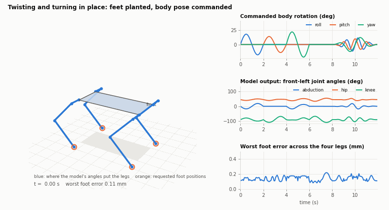

# Mojito


Robots that learn to move in their environment by themselves: a first idea of
the task from simulation, then refinement from real interaction, with return
trips to simulation to prepare for specific tasks.

The first robot is a quadruped with 12 degrees of freedom, 3 per leg:
abduction and hip pitch at the shoulder, and a knee. The feet are grippy pads.



*Every leg in this animation is drawn from the joint angles a trained neural
network produced. The orange rings are where the feet were asked to be.*

## Website

A static site with a progress report, the theory and implementation, every result graphed, all the demos, and a playground
where the robot's dimensions, posture, gait, mass and servo settings can be changed (a live kinematic lab, and a replay of 144 recorded
MuJoCo runs). It reads the numbers from the JSON files under `results/`; it holds none of its own.

```bash
python scripts/website/build_site.py                 # site/data and site/media from results/ (not committed)
python -m http.server -d site 8000           # open http://127.0.0.1:8000
python scripts/website/site_sweep.py                 # re-run the 144 MuJoCo runs behind the physics lab (needs mujoco, about 2 minutes)
```

**Live physics, local only.** `python scripts/website/serve_site.py` (needs `mujoco`) serves the same site on `127.0.0.1:8000` and adds a third playground tab, "Live physics", where the Python simulation runs in real time behind the page: any link length, body size, stand height, mass, gait, servo gain or supply voltage, in real physics. It refuses other hosts and origins, and nothing leaves your machine. On the published site that tab explains how to run it.

The `site` workflow publishes it with GitHub Pages when `main` changes (one-time: Settings, Pages, Source: GitHub Actions). The kinematic lab uses
the closed-form IK in JavaScript (`site/assets/mojito.js`), checked against the Python by `tests/website/test_site_js.py` (needs Node).

## Status

| Stage | What | State |
|---|---|---|
| 0 | One network learns inverse kinematics for a leg, with link lengths as inputs | Done |
| 1 | Whole body: posture control, trot and crawl, NumPy or PyTorch | Done |
| – | Robots defined in URDF; the network is generated from it | Done |
| 2 | Physics simulation (MuJoCo) and learned locomotion | In progress: MuJoCo model, servo/sensor model, stand tests and gait replay in physics done (work packages 0–4 of 8); design sweep next |
| 3 | The real robot: measurement, calibration, per-leg correction | Planned |
| 4 | The loop: real experience updates the simulator, retrain, redeploy | Planned |

The reasoning behind each stage is in [docs/PLAN.md](docs/PLAN.md).

**Read this before trusting any number in these pages.** Stages 0 and 1 are geometry only:
there is no physics in them, so nothing here says the robot would balance, that
its motors are strong enough, or that its feet would grip. All dimensions and
joint limits are placeholders, not a real robot's:

| Placeholder | Value |
|---|---|
| Abduction offset / upper leg / lower leg | 40 / 120 / 120 mm |
| Shoulder spacing, front to back / side to side | 240 / 100 mm |
| Standing height of the shoulders | 170 mm |
| Joint limits: abduction / hip pitch / knee | ±0.6 / 0 to 1.5 / −2.3 to −0.3 rad |

These are the Stage 0–1 (geometry) placeholders. The Stage 2 physics results use larger ones, so the servos are not oversized: 50 / 150 / 150 mm links, 300 × 150 mm shoulder spacing, 212.5 mm standing height (`docs/STAGE2.md`). The trot has a 1.7 s period everywhere. The Stage 1 demos were first made at 0.5 s; a period sweep in physics showed that was not optimal and they were regenerated at 1.7 s (`docs/PHYSICS.md`). The physics trot is tuned further (22 mm swing, 160 mm stance, kp 50, kd 0.9; `docs/STAGE2.md`); the crawl keeps the 212.5 mm stance.

## Quick start

Linux or macOS, no GPU needed. You need `git` and `curl`; everything else is installed for you:
[uv](https://docs.astral.sh/uv/) (Python and the virtual environment, fetches Python 3.10+ itself) and
[just](https://just.systems) (the task runner).

```bash
git clone https://github.com/mi897/mojito && cd mojito
./scripts/setup.sh            # installs uv and just if missing, then the dependencies
just test                     # all tests; the PyTorch ones skip if torch is absent
just body                     # re-render the animations from the trained network
just                          # list every task
```

PyTorch is optional. `./scripts/setup.sh --torch` installs the CUDA build if an NVIDIA GPU is detected and the CPU build
otherwise; `--gpu` or `--cpu` force one and skip detection. Already have uv and just? `just setup` (same flags) does the dependency step alone. Without just, prefix any command in this README
with `uv run --extra sim`, for example `uv run --extra sim python scripts/body/make_body_demos.py`. Dependencies live in
`pyproject.toml`; `uv.lock` pins exact versions.

The trained network is in the repository (`weights/ik_leg.npz`), so nothing
needs training to try it. Open `docs/demo.html` in a browser to drag a foot
target around and change the link lengths live.

| Script | What it does | Writes |
|---|---|---|
| `scripts/learning/train.py` | Train the leg network (about 12 minutes on 2 CPU cores) | `weights/ik_leg.npz`, `results/learning/training_log.json` |
| `scripts/learning/evaluate.py` | Compare the network with exact IK | `results/learning/metrics.json`, four plots |
| `scripts/learning/calibrate.py` | Adapt to a simulated leg with unknown lengths | `results/learning/calibration.json` |
| `scripts/learning/make_demo.py` | Single-leg demos | `results/learning/step_demo.gif`, `docs/demo.html` |
| `scripts/body/make_body_demos.py` | Posture, trot and crawl animations (`--no-gif` for numbers only) | four GIFs, `results/body/body_metrics.json` |

Every script takes `--backend numpy|torch` and `--help`.

## Where things are

| Page | What is in it |
|---|---|
| [docs/USAGE.md](docs/USAGE.md) | Python examples: one leg, whole body, NumPy or PyTorch, retraining, robots from URDF |
| [docs/RESULTS.md](docs/RESULTS.md) | Stage 0 and Stage 1 results, and how the leg network, body and gaits work |
| [docs/PHYSICS.md](docs/PHYSICS.md) | Stage 2 physics results (mass bound, standing, gait replay) and the live gait explorer |
| [docs/PLAN.md](docs/PLAN.md) | The staged roadmap and the reasoning behind it |
| [docs/STAGE2.md](docs/STAGE2.md) | The current stage: MuJoCo, servo model, work packages |
| [docs/NAMING.md](docs/NAMING.md) | Naming and equation-commenting conventions |

## Repository layout

```
mojito/                the library, in four subpackages (each holds at most about a dozen files)
  geometry/            urdf.py (read and write URDF, no NumPy), spec.py (URDF + manifest -> LimbSpec / RobotSpec),
                       kinematics.py (FK, Jacobian, numeric IK for any serial chain), robots.py (generators for robots/)
  robot/               leg.py (3-joint leg, closed-form IK reference), body.py (legs on a body: frames, posture, per-leg solving),
                       gaits.py (trot, crawl, stability margin), statics.py (static joint torques, mass bound)
  learning/            model.py (IK network, NumPy, Adam), torch_model.py (PyTorch backend), backend.py (make_model, load_model)
  sim/                 mjcf.py (MuJoCo model from a URDF), actuators.py (servo model), sensors.py (joint sensor, IMU),
                       stand.py, gait_replay.py, gait_plots.py, live_sim.py (need mujoco, except actuators and sensors)
robots/                one folder per robot (quadruped/, hexapod/, planar/), each with its .urdf and .json manifest
site/                  website: pages, assets/mojito.js (JS port of leg, body, gaits, statics), charts, viewer, playground; data/ and media/ are generated
scripts/               entry points, one folder per topic
  learning/            train, evaluate, calibrate, make_demo
  body/                make_body_demos, torque_envelope
  stand/               stand_test, sit_to_stand, make_stand_demo
  gait/                gait_replay, gait_speed_diagnosis, pace_diagnosis, make_gait_replay_demo, make_gait_iso_demos, try_gait, live_gait (+ live_gait.html)
  gait/sweeps/         trot_period_sweep, trot_period_robustness, trot_1p7_parameter_sweep, trot_1p7_one_at_a_time, trot_1p7_kp_kd_grid, trot_1p7_combined
                       and a plot_<name> for each (outputs in results/gait/sweeps/{period,parameters,servo_gains,combined}/)
  website/             build_site, serve_site, site_sweep, make_og_image, make_favicon
tests/                 unittest suites, mirroring the layout: geometry/, robot/, learning/, sim/, website/
weights/ik_leg.npz     the trained leg network
results/               generated, committed: learning/, body/, stand/, gait/ (json metrics, png plots, gif animations); gait/sweeps/ has period/, parameters/, servo_gains/, combined/
docs/NAMING.md         naming and equation-commenting conventions
docs/USAGE.md  RESULTS.md  PHYSICS.md   usage, geometry results, physics results
docs/PLAN.md           roadmap;  docs/STAGE2.md  current stage
docs/demo.html         interactive single-leg demo (generated from demo_template.html)
CLAUDE.md              conventions and working rules for AI coding assistants
```

`weights/`, `results/` and `docs/demo.html` are generated by the scripts and
committed so this page renders. Regenerate them rather than editing by hand.

## Working on this

- Work on a branch named for the change; `main` only receives merges.
- Run `python -m unittest discover tests` before committing. GitHub runs the
  same tests, a short training run and the scripts on both backends for every
  push.
- New maths needs a test against something independent: finite differences,
  the closed-form IK, or a property such as "grounded feet do not move".
- Numbers quoted here must come from a run, and must say what was measured.

## Open questions

These decide what Stage 2 and 3 look like.

1. The real link lengths, abduction offset, body dimensions and joint limits.
   No robot exists yet; the plan is to try dimensions in simulation first
   (`docs/STAGE2.md`).
2. Actuators: decided as 20 kg·cm hobby servos (listed as "DSServo DS3218 20KG
   Digital Metal Servo"), supply adjustable 5–6 V, no position feedback. The first
   robot gets external joint-angle sensors; DC motors with position, velocity and
   current feedback come later. The sensors sit in line with each joint axis, close to the motor. The sensors are custom Hall-effect boards. Still open: the datasheet figures (the 5–6 V
   range is interpolated from listed 5 V and 6.8 V points). The Hall chip and magnet details are tabled. The controller is an ESP32 driving a PCA9685, with an IMU wired to the ESP32 (no Raspberry Pi); one battery with separate servo and logic regulators.
   The torque and speed figures in `docs/STAGE2.md` come from retailer
   listings and are unverified.
3. How foot or body position will be measured on the real robot. Simulation
   ground truth is used for now; an external system can come later. Everything
   learned from real interaction depends on this.
