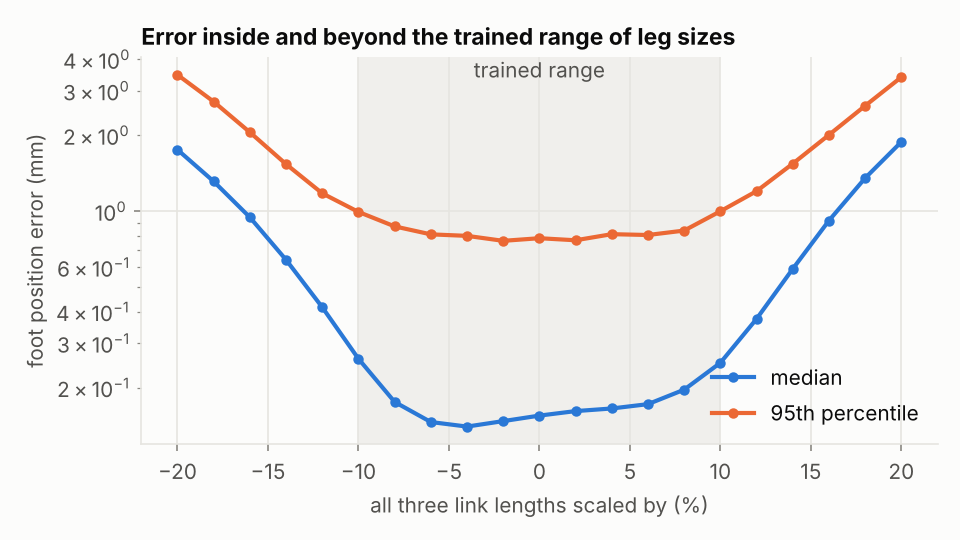
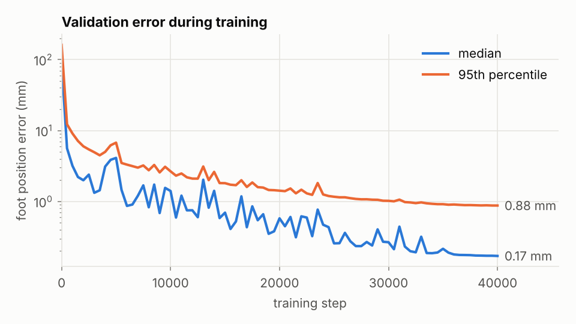
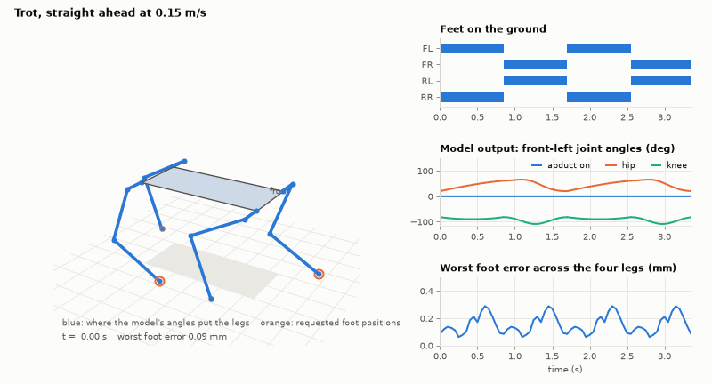
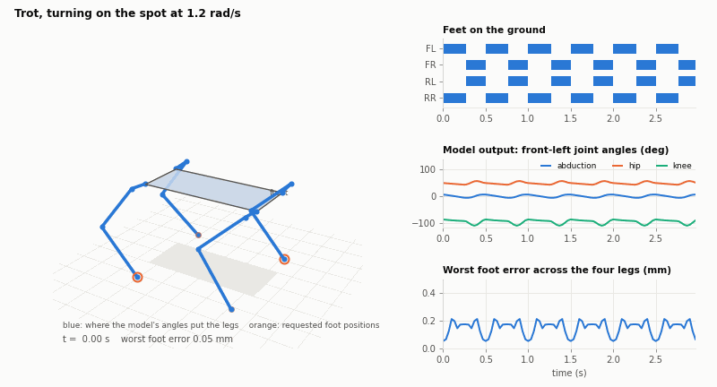
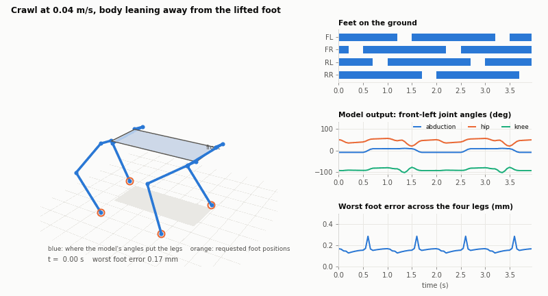

[Back to the README](../README.md)

# Results

All numbers come from the JSON files in `results/`, produced by the scripts
above with the committed weights.

## Stage 0: one leg

Each link length was varied independently by ±10% in training. Tested on
200,000 foot targets and leg sizes the network never saw. The leg reaches
240 mm.

| Foot position error | Median | 95th pct | 99th pct | Worst |
|---|---|---|---|---|
| Network, told each leg's lengths | 0.17 mm | 0.84 mm | 1.57 mm | 7.4 mm |
| Network, assuming every leg is nominal | 9.0 mm | 15.7 mm | 18.8 mm | 38.3 mm |
| Closed-form IK on an ideal leg | exact | exact | exact | exact |

- **The length input is what makes one network cover many legs.** Without it
  the median error is about 50 times larger.
- **Joint angles** are within 0.04° of the exact solution at the median and
  0.53° at the 95th percentile.
- **The worst cases are at the edge of the workspace** (error map below). The
  7.4 mm worst case is real and is about 3% of the leg's reach.
- **Outside the trained range** accuracy falls off smoothly: with all links
  scaled by ±20% the median is 1.8 to 1.9 mm.
- **On an ideal leg the closed-form solution is better.** It is exact and
  about 40 times faster in a batch. The network earns its place only by being
  adaptable, which is the next result.

**Adapting to one specific leg.** `scripts/learning/calibrate.py` simulates a leg whose
true lengths (+6%, −5%, +8%) and servo zero points (2°, −3°, 4°) are unknown.
From 30 foot measurements with 1 mm of noise it estimates all six numbers and
hands the lengths to the same network. Nothing is retrained.

| | Median error | 95th pct |
|---|---|---|
| Before calibration | 16.1 mm | 18.6 mm |
| After calibration | 0.56 mm | 0.74 mm |

| | |
|---|---|
|  |  |
|  |  |

## Stage 1: whole body

One shared network drives all four legs. In each animation the side panels
show the command, the network's output for the front-left leg, and the worst
foot error at that instant.

| Trot, straight | Trot, turning on the spot |
|---|---|
|  |  |

| Crawl, leaning away from the lifted foot |
|---|
|  |

| Demo | Worst foot error | Median | Closest any joint gets to its limit | Feet down |
|---|---|---|---|---|
| Posture: roll ±18°, pitch ±14°, yaw ±22°, height ±30 mm | 0.22 mm | 0.11 mm | 15° | 4 |
| Trot forward, 0.15 m/s | 0.29 mm | 0.11 mm | 20° | 2 |
| Trot turning on the spot, 1.2 rad/s | 0.21 mm | 0.10 mm | 10.8° | 2 |
| Crawl forward, 0.04 m/s | 0.29 mm | 0.12 mm | 20° | 3 or 4 |

- Every requested foot position in all four demos is inside the joint limits.
  The network's angles differ from the exact solution by at most 0.14°.
- **Grounded feet do not slide.** The gait generator holds each stance foot
  fixed in the world for any mix of forward, sideways and turning speed. The
  tests check this to a nanometre using exact IK.
- **The crawl is statically stable on paper.** The body centre stays at least
  37 mm inside the triangle of grounded feet. This treats the body centre as
  the centre of mass, which is an assumption.

The trot demos have a 1.7 s period. They were first made at 0.5 s, a period set before any physics; the physics replays showed that was not optimal, a period sweep in MuJoCo gave 1.7 s (`docs/STAGE2.md`, "Longer trot periods"), and these demos were regenerated at 1.7 s. The geometry numbers changed with it: the worst forward-trot foot error went from 0.25 to 0.29 mm, the closest joint approach in the turn from 22° to 10.8°, and the body centre's distance from the line between grounded feet from 11 to 38 mm (the longer stance sweeps the feet through a larger angle).

Known weaknesses of these motions:

- The trot has two feet down, so it relies on dynamic balance that geometry
  cannot check. With two feet the body centre is never inside a support
  polygon: in the forward trot it ends up as much as 38 mm off the line
  between the grounded feet (`body_centre_inside_support_mm_min` in
  `results/body/body_metrics.json`).
- The crawl's lean is quick: the body shifts 50 mm in 0.2 s.
- The gaits take a constant velocity command. Changing speed mid-stride is
  not handled yet.

## How it works

**The leg network.** Inputs are the foot target (3 numbers) and the leg's
three link lengths. Outputs are three joint angles, squashed so they always
lie inside the joint limits. It has 3 hidden layers of 128 units, about 34,000
weights.

- **Training data.** Random joint angles are pushed through forward kinematics
  to get foot positions, so every target is reachable. Poses are resampled so
  foot positions cover the workspace more evenly.
- **Loss.** The predicted angles are pushed through forward kinematics and
  compared with the requested foot position. The network is never shown the
  angles that generated the target, so it cannot average two valid poses into
  an invalid one.
- **One answer per target.** The knee bends one way only and stops 0.3 rad
  short of straight.
- **One model for four legs.** A right leg is the mirror image of a left leg:
  flip the target's y on the way in and the abduction angle on the way out.
- **Gradients.** The NumPy backend uses a hand-derived Jacobian, checked
  against finite differences. The PyTorch backend uses autograd.

**The body.** `body.Robot` holds the four shoulder positions and each leg's
lengths. A body pose or gait produces foot targets in the body frame; each is
moved into its leg's shoulder frame and solved by the leg network.

**Gaits.** A foot in stance is held fixed on the ground, so in the body frame
it moves exactly opposite to the commanded body motion. A foot in swing lifts
and travels to where its next stance begins. Trot moves diagonal pairs
together. Crawl lifts one foot at a time and shifts the body away from it
while all four are down.

**Frames and units.** Metres and radians in code. Leg frame: origin at the
shoulder, x forward, y out to the side, z up. Body frame: origin at the centre
of the four shoulders, x forward, y left, z up. Legs are always ordered FL,
FR, RL, RR.
